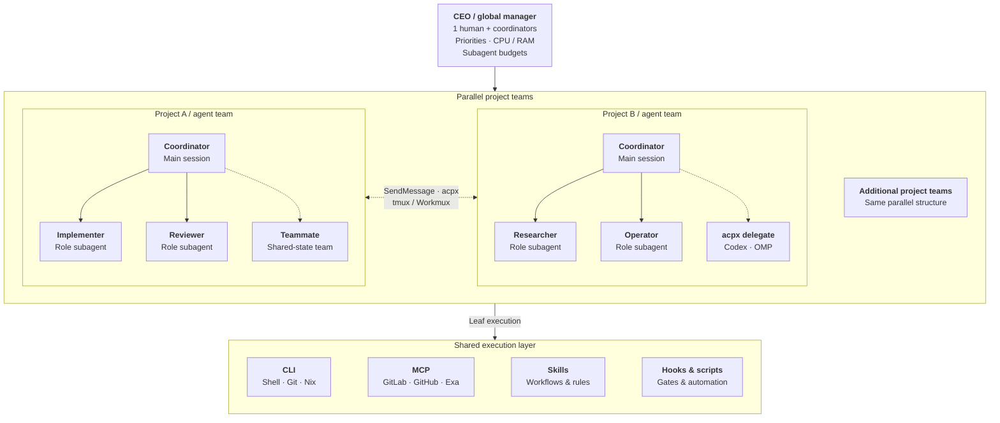

# Agent company

One human steers multiple repositories in parallel by treating each workspace as an autonomous agent team backed by shared tools and automated guardrails.

## Recommended stack

| Layer           | Tools                                                    | Role                                                    |
| --------------- | -------------------------------------------------------- | ------------------------------------------------------- |
| Agent harnesses | [Claude Code], [Codex], [Oh My Pi] (`omp`)               | Multi-harness CLI agents packaged via [llm-agents.nix]  |
| Delegation      | Role subagents, Agent Teams, [acpx] (ACP)                | Parallel role fan-out and cross-harness dispatch        |
| Workspaces & UI | [Workmux], [tmux], [T3 Code], [ccusage]                  | Isolated Git worktrees, session GUI, and spend tracking |
| Execution       | [MCP] ([GitLab MCP], [GitHub MCP], [Exa MCP])            | Uniform forge, search, and external API reach           |
| Guardrails      | Skills ([hakulab/plugins]), pre-commit and harness hooks | Reusable workflows, lint gates, and permission checks   |

## Model tiering

| Tier     | Roles                                                        | Effort & gate                                           |
| -------- | ------------------------------------------------------------ | ------------------------------------------------------- |
| Flagship | `coordinator`, `architect`, `reviewer`, `debugger`, `tester` | High effort for planning, design, review, and debugging |
| Standard | `implementer`                                                | Bounded edits paired with flagship review               |
| Mini     | `researcher`, `operator`                                     | Fast read-only lookups and approved operations          |
| Prose    | `doc-writer`                                                 | Dedicated prose model (or flagship) for docs and copy   |

[Claude Code]: https://github.com/anthropics/claude-code
[Codex]: https://github.com/openai/codex
[Oh My Pi]: https://github.com/can1357/oh-my-pi
[llm-agents.nix]: https://github.com/numtide/llm-agents.nix
[acpx]: https://github.com/openclaw/acpx
[Workmux]: https://github.com/raine/workmux
[tmux]: https://tmux.github.io/
[T3 Code]: https://github.com/pingdotgg/t3code
[ccusage]: https://ccusage.com/
[MCP]: https://modelcontextprotocol.io/
[GitLab MCP]: https://github.com/zereight/gitlab-mcp
[GitHub MCP]: https://github.com/github/github-mcp-server
[Exa MCP]: https://github.com/exa-labs/exa-mcp-server
[hakulab/plugins]: https://github.com/hakulab/plugins
